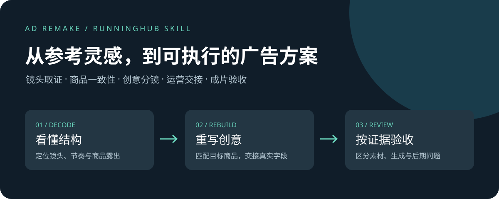

**English** | [简体中文](README.zh-CN.md)

# Ad Creative Reconstruction Studio

### Turn a reference ad into a creative plan for your own product.

**ad-remake-runninghub** connects reference analysis, product recognition, storyboarding, and output review. Give your team more than a prompt: deliver a production plan with traceable inputs, clear handoffs, and actionable feedback.

Built for operators with a local reference ad, product images, and verified selling points, this Skill helps an agent analyze pacing, define product appearance checkpoints, write a new storyboard, map real application fields, and review the resulting video.

> This is a planning, evidence, application handoff, and review Skill. It does not include a video model or an API client for automatic RunningHub submission. The selected application generates the video; an agent can operate its website when authorized and equipped to do so.



**[Download the Skill](https://github.com/ultimatech-cn/ad-remake-runninghub/releases/latest)** · [Agent instructions · 中文](SKILL.md) · [Detailed case · 中文](EXAMPLE.md) · [Handoff specification · 中文](references/handoff.md)

## What it does

| Your input | What the Skill helps the agent do | Deliverable |
|---|---|---|
| Local reference ad or timestamped frames | Analyze candidate cuts, movement, product exposure, and ending | Reference breakdown with time evidence |
| Target product images | Identify 3–5 checks for silhouette, color, marks, and components | Product consistency checklist |
| Verified selling points and campaign requirements | Decide which structural elements to retain or replace; write an approximately 15-second storyboard | New ad plan and suggested post-production copy |
| Current RunningHub page | Check available fields, files, fees, and thumbnails | Two-field handoff and execution record |
| Actual output video | Review product, typography, framing, movement, and sound by timestamp | Pass / revise / not tested findings and repair suggestions |

The helper script extracts candidate cuts and evidence frames. The agent interprets them and develops the creative plan. Flames, rapid motion, and dissolves can cause false positives or missed cuts; candidates still need visual review.

## Connected application

[RunningHub: Reference Ad Reconstruction](https://www.runninghub.cn/ai-detail/2108035405940613122)

The historical page check on **November 13, 2026** identified two inputs:

1. **Reference ad video:** an actual video file; frames are for analysis only.
2. **Product image:** the complete target image; verify its upload preview before submission.

This page has no general storyboard or prompt field. Storyboards support communication and review; map text to a generation field only when a supplied workflow actually provides one. Approximately 15 seconds in portrait format is a historical planning baseline. Recheck live fields, dimensions, fees, and availability before running.

## Example: Folgers structure → Lavazza plan, with a separate perfume run

The [detailed case · 中文](EXAMPLE.md) distinguishes the planning example from the actual application output:

- **Planning example:** analyze a roughly 14.48-second reference, identify candidate cuts near 1.13 and 7.77 seconds, and adapt “person/shopping context → supermarket space → product ending” for a red-and-silver Lavazza pouch.
- **Actual application run:** the product field still contained a perfume image when the historical task was submitted. The application produced a 15.10-second perfume ad. This demonstrates a working generation path, **not a successful Lavazza recreation**.
- **Diagnosis:** the wrong upload was not caught during input verification. The record does not attribute it to the application changing the product. No additional generation was submitted.

The repository demonstrates this workflow through a written plan and structured evidence example. It does not redistribute the original ad, Lavazza product photograph, or perfume input/output with incomplete provenance. Those historical files remain in the original delivery.

## Install and invoke

Download the release ZIP. Its extracted Skill directory contains:

```text
ad-remake-runninghub/
  SKILL.md
  references/handoff.md
  scripts/probe_video.py
```

| Host | Installation location or entry point | Recorded status |
|---|---|---|
| Codex | `~/.codex/skills/ad-remake-runninghub/` | Historical fresh-session explicit invocation produced a plan |
| DeepSeek Harness | Project `.dsh/skills/ad-remake-runninghub/` | Directory adaptation provided; target-session triggering not tested |
| WorkBuddy | Upload Skill in the client's skill manager | Client import/triggering not tested; check the current client UI |

The host needs local image/video access. The helper script requires Python 3.10+ and FFmpeg. A text-only chat environment cannot perform media evidence extraction or operate the application. The agent instructions and detailed operator documents are currently in Chinese; the prompt below requests an English delivery.

```text
Use ad-remake-runninghub. Reply and deliver the plan in English.
Reference: /absolute/path/reference.mp4
Product: /absolute/path/product.jpg
Goal: an approximately 15-second portrait ad.
Use only the product facts I provide.
Deliver timestamped reference evidence, a product consistency checklist,
a new storyboard, and a handoff mapped to the actual application fields.
If there is no actual output video, mark output review as not tested;
do not present a plan as a generated result.
```

## Local evidence helper

The script uses the Python standard library. Install FFmpeg separately.

```bash
python3 scripts/probe_video.py /path/to/reference.mp4 /path/to/new-evidence-folder

# Optional FFmpeg path and cut threshold
python3 scripts/probe_video.py /path/to/reference.mp4 /path/to/new-evidence-folder \
  --ffmpeg /path/to/ffmpeg --threshold 0.30
```

It outputs candidate cuts, three frames per interval (early/middle/late), and `evidence.json`. The output directory must be new. An audio-stream flag only confirms a stream exists; it does not mean the audio has been heard or transcribed.

## How it differs from rh-video-replica

[RH Video Replica](https://github.com/ultimatech-cn/rh-video-replica) focuses on scripted API task management and deterministic post-production. This Skill focuses on **planning, evidence, the two-field handoff, and review for a specific RunningHub advertising application**. Their test results are separate.

## License and media

Original code and documentation use the [MIT License](LICENSE). Third-party advertising and product names identify the case only and imply no affiliation or endorsement. Reference provenance appears in the [case · 中文](EXAMPLE.md); this repository does not grant commercial rights to third-party media.
